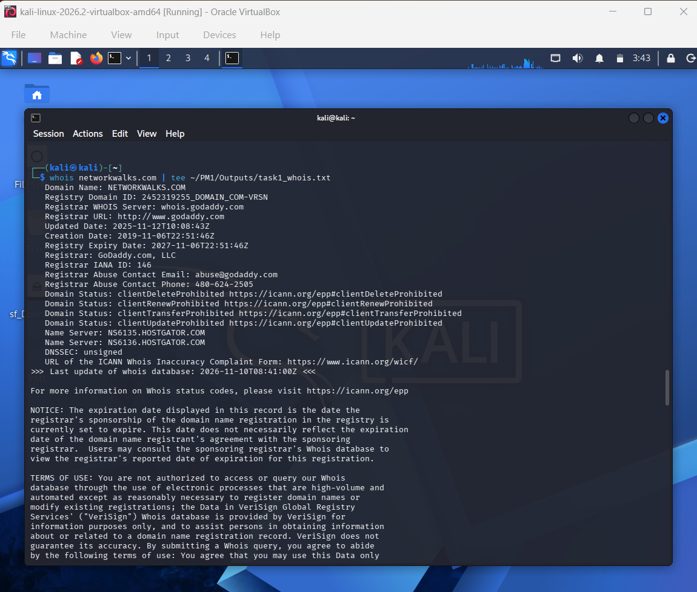
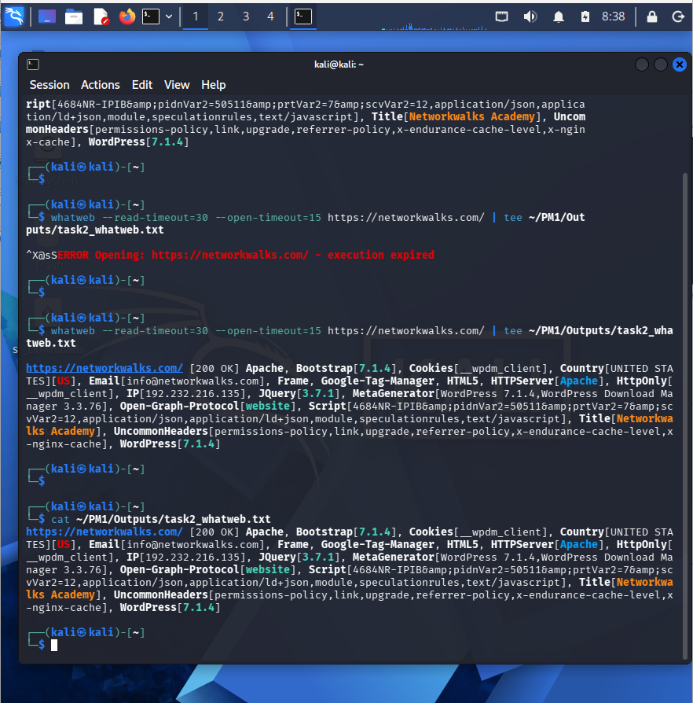
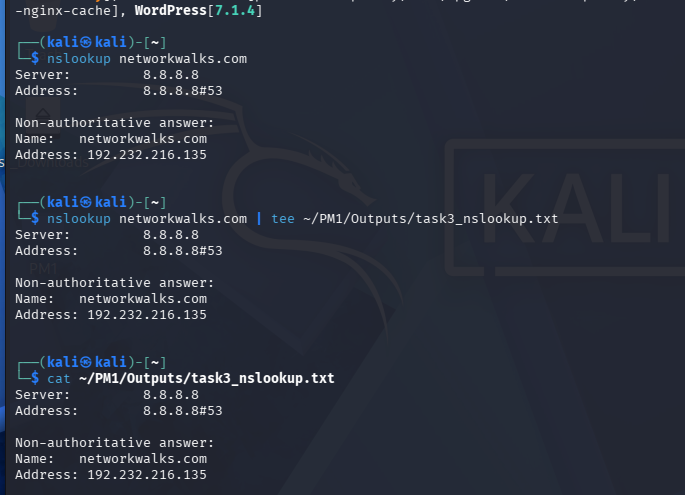
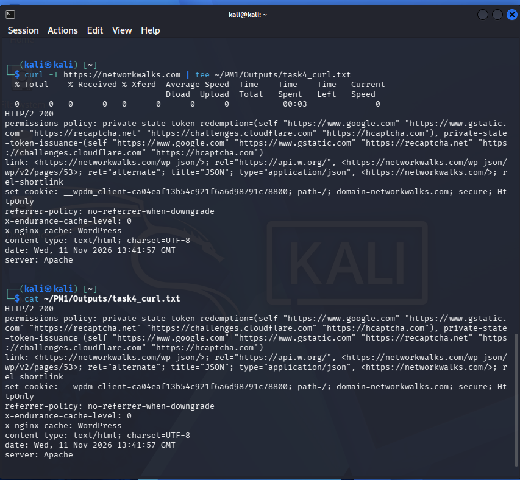
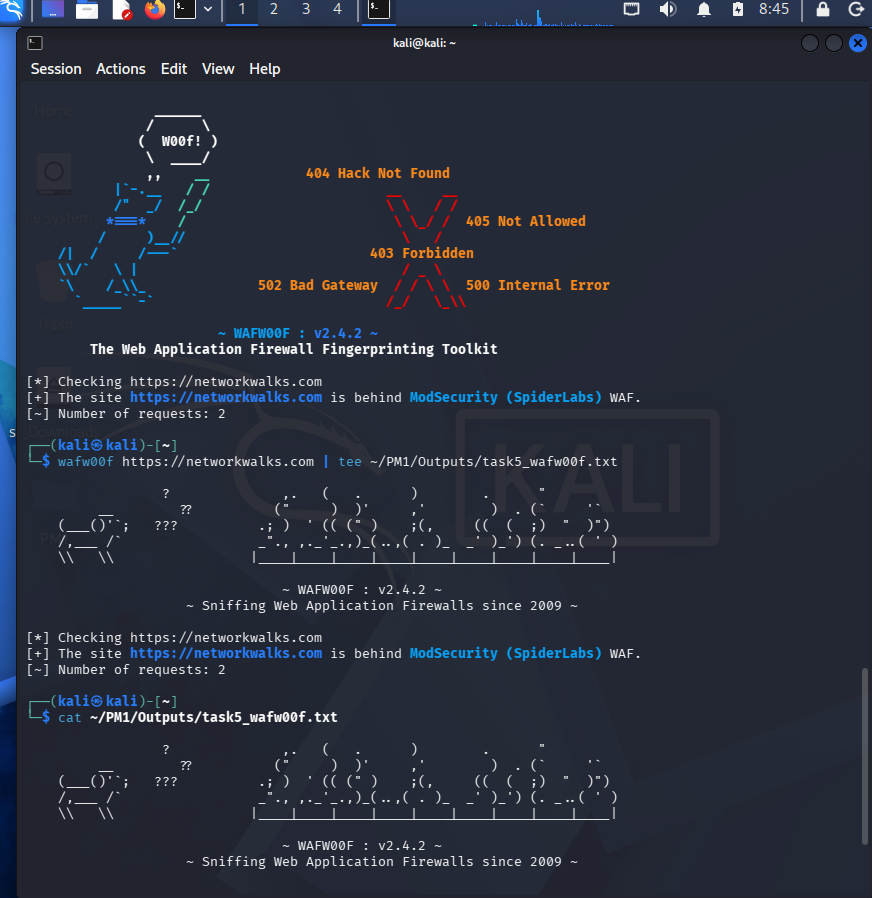
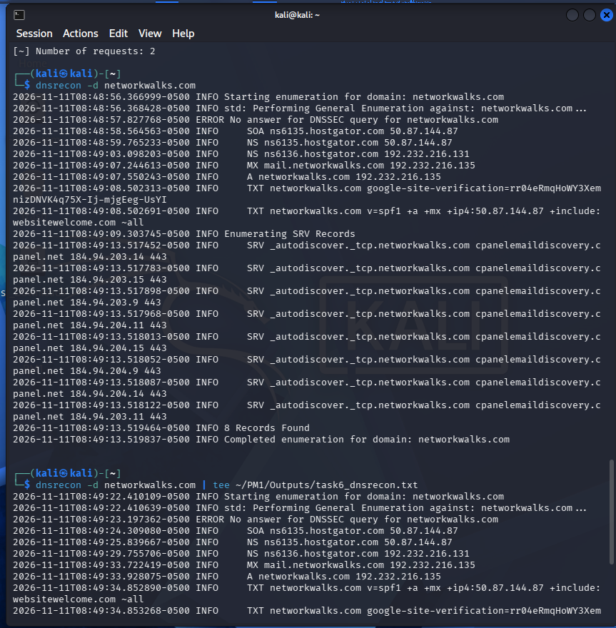

<div align="center">

# 🔐 Footprinting & Reconnaissance Using Kali Linux

### A Hands-on Cybersecurity Practical Project


</div>

---

## 📌 About This Project

As part of my cybersecurity practical training, I worked on footprinting and reconnaissance using Kali Linux.

The main purpose of this practical was to understand how information about a website and its domain can be collected using different command-line tools.

I performed six tasks using WHOIS, WhatWeb, Nslookup, cURL, Wafw00f and DNSRecon. Each tool helped me understand a different part of the information-gathering process, including domain details, website technologies, DNS records and HTTP headers.

**Target Domain:** `networkwalks.com`

## 🎯 Objectives

- Understand the basics of footprinting and reconnaissance.
- Collect publicly available domain information.
- Identify website technologies and frameworks.
- Retrieve DNS information.
- Analyze HTTP response headers.
- Check for web application firewall indicators.
- Perform DNS enumeration.
- Save practical outputs and screenshots for documentation.

## 🛠️ Tools Used

| Tool | Purpose |
|---|---|
| WHOIS | Domain registration information |
| WhatWeb | Website technology identification |
| Nslookup | DNS information gathering |
| cURL | HTTP response header analysis |
| Wafw00f | Web Application Firewall detection |
| DNSRecon | DNS enumeration |
| Kali Linux | Security testing environment |
| VirtualBox | Virtualization platform |

## 🏗️ Project Workflow

```text
                 Kali Linux
                     |
                     |
              Target Domain
            networkwalks.com
                     |
                     |
         Footprinting & Reconnaissance
                     |
        ┌────────────┼────────────┐
        |            |            |
      WHOIS       WhatWeb      Nslookup
        |            |            |
        └────────────┼────────────┘
                     |
                cURL Analysis
                     |
                  Wafw00f
                     |
                  DNSRecon
                     |
                     |
               Result Analysis
                     |
              Save Text Outputs
                     |
                Screenshots
                     |
              Final Documentation
```

## ⚙️ Environment Configuration

| Component | Details |
|---|---|
| Operating System | Kali Linux |
| Virtualization | Oracle VirtualBox |
| Target Domain | networkwalks.com |
| Working Directory | `~/PM1/` |
| Output Folder | `~/PM1/Outputs/` |
| Screenshot Folder | `~/PM1/Screenshots/` |
| Report Folder | `~/PM1/Report/` |

---

## 🪜 Practical Implementation

### 1. WHOIS – Domain Information Gathering

I used WHOIS to collect publicly available registration information about the target domain.

**Command:**

```bash
whois networkwalks.com
```

**Purpose:**
- Check domain registration information.
- Understand domain ownership-related public records.
- Collect available registrar and registration details.

**Output:** `outputs/task1_whois.txt`

### 2. WhatWeb – Website Technology Identification

I used WhatWeb to identify the technologies and frameworks that could be detected on the website.

**Command:**

```bash
whatweb --read-timeout=30 --open-timeout=15 https://networkwalks.com/
```

**Observed Technologies:**

- Apache
- WordPress
- Bootstrap
- jQuery
- Google Tag Manager
- HTML5

The scan returned an HTTP 200 OK response.

**Output:** `outputs/task2_whatweb.txt`

### 3. Nslookup – DNS Information Gathering

I used Nslookup to retrieve DNS information associated with the target domain.

**Command:**

```bash
nslookup networkwalks.com
```

**Purpose:**
- Check domain name resolution.
- Retrieve DNS information.
- Understand how domain names resolve to IP addresses.

**Output:** `outputs/task3_nslookup.txt`

### 4. cURL – HTTP Header Analysis

I used cURL to send an HTTP HEAD request and examine the response headers returned by the website.

**Command:**

```bash
curl -I https://networkwalks.com
```

**Purpose:**
- Inspect HTTP response headers.
- Understand server response information.
- Examine website communication details.

**Output:** `outputs/task4_curl.txt`

### 5. Wafw00f – Web Application Firewall Detection

I used Wafw00f to check whether a Web Application Firewall could be identified on the target website.

**Command:**

```bash
wafw00f https://networkwalks.com
```

**Purpose:**
- Check for identifiable WAF information.
- Understand the role of web application firewalls.
- Learn basic firewall detection techniques.

**Output:** `outputs/task5_wafw00f.txt`

### 6. DNSRecon – DNS Enumeration

I used DNSRecon to perform DNS enumeration and collect different DNS records associated with the domain.

**Command:**

```bash
dnsrecon -d networkwalks.com
```

**Observed Findings:**

- SOA record
- Name Server (NS) records
- Mail Exchange (MX) record
- A record
- TXT records
- SRV records

DNSRecon reported **8 records found**.

It also displayed a DNSSEC query error, but the general enumeration completed successfully.

To save the complete terminal output, including error-stream messages, I used:

```bash
dnsrecon -d networkwalks.com 2>&1 | tee ~/PM1/Outputs/task6_dnsrecon.txt
```

**Output:** `outputs/task6_dnsrecon.txt`

---

## 📸 Project Screenshots

The following screenshots document the practical tasks performed using Kali Linux.

### 1. WHOIS – Domain Information Gathering



### 2. WhatWeb – Website Technology Identification



### 3. Nslookup – DNS Information Gathering



### 4. cURL – HTTP Header Analysis



### 5. Wafw00f – Web Application Firewall Detection



### 6. DNSRecon – DNS Enumeration



---

## 📂 Project Folder Structure

```text
NETWORKWALKS-WK2-FOOTPRINTING-RECONNAISSANCE/
│
├── README.md
│
├── screenshots/
│   ├── whois.png
│   ├── whatweb.png
│   ├── nslookup.png
│   ├── curl.png
│   ├── wafw00f.png
│   └── dnsrecon.png
│
├── outputs/
│   ├── task1_whois.txt
│   ├── task2_whatweb.txt
│   ├── task3_nslookup.txt
│   ├── task4_curl.txt
│   ├── task5_wafw00f.txt
│   └── task6_dnsrecon.txt
│
└── Report/
    └── PM1_Final_Report.pdf
```

## 📊 Practical Progress

| Task | Tool | Status |
|---|---|---|
| Task 1 | WHOIS | Output file created |
| Task 2 | WhatWeb | Output saved and checked |
| Task 3 | Nslookup | Output file created |
| Task 4 | cURL | Output file created |
| Task 5 | Wafw00f | Output file created |
| Task 6 | DNSRecon | Terminal execution successful; saved output verification pending |

## 📚 What I Learned

While completing this practical, I learned:

- How to use different reconnaissance tools in Kali Linux.
- How to collect publicly available domain information.
- How to identify website technologies using WhatWeb.
- How DNS records work and how to retrieve them.
- How to inspect HTTP response headers.
- How to check for web application firewall indicators.
- How to perform basic DNS enumeration.
- How to save command outputs and maintain practical documentation.

This practical helped me understand how these tools are used during the initial information-gathering stage of a cybersecurity assessment.

## 🔍 Challenges Faced

During the practical, I faced a few issues:

- WhatWeb initially experienced connection timeouts.
- I adjusted the connection timeout values and successfully obtained the website information.
- DNSRecon displayed a DNSSEC query error while performing enumeration.
- The initial DNSRecon output file was empty because the log messages were not captured by the original `tee` command.
- I learned to redirect both output streams when saving terminal results.

These issues helped me understand basic troubleshooting in Kali Linux.

## 🔐 Responsible Use

This practical is intended for educational purposes and authorized security testing.

Reconnaissance should only be performed against systems and domains that I own or have explicit permission to assess.

## 🏁 Conclusion

This practical gave me an opportunity to work with different reconnaissance tools instead of only learning their commands theoretically.

By completing these six tasks, I gained hands-on experience with domain information gathering, website fingerprinting, DNS lookup, HTTP header analysis, firewall detection and DNS enumeration.

I will continue improving my practical knowledge by working with more cybersecurity tools and lab exercises.

---

## 👩‍💻 About Me

**Rajshree ML**

